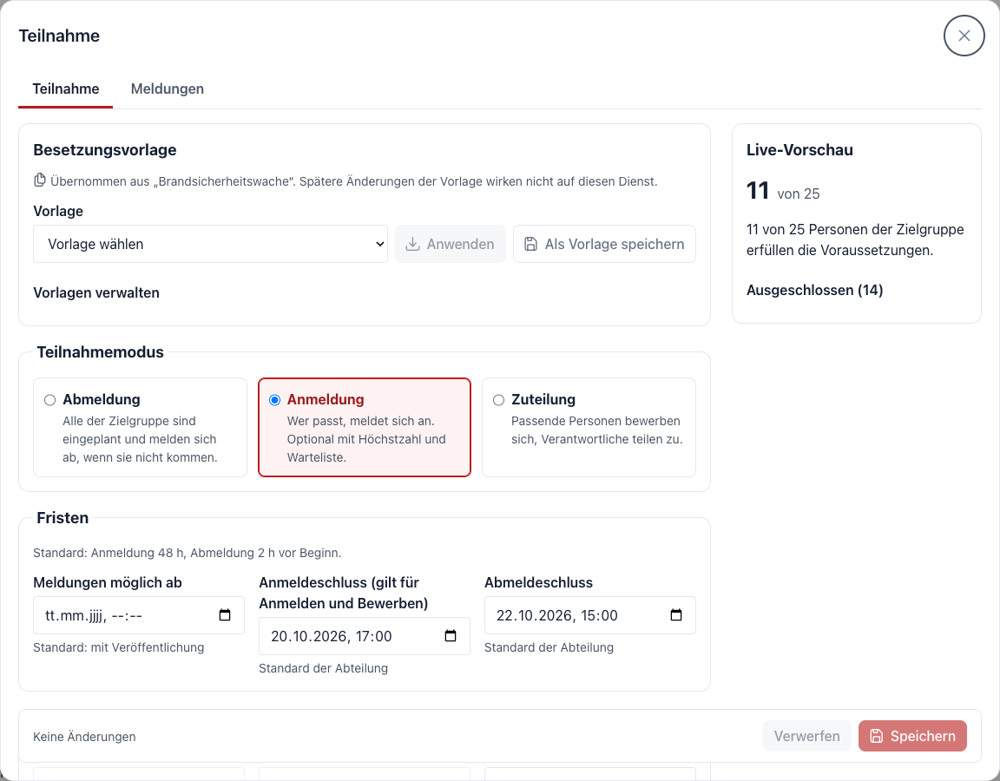
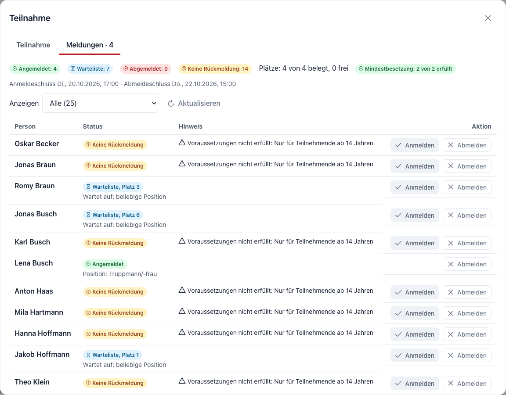
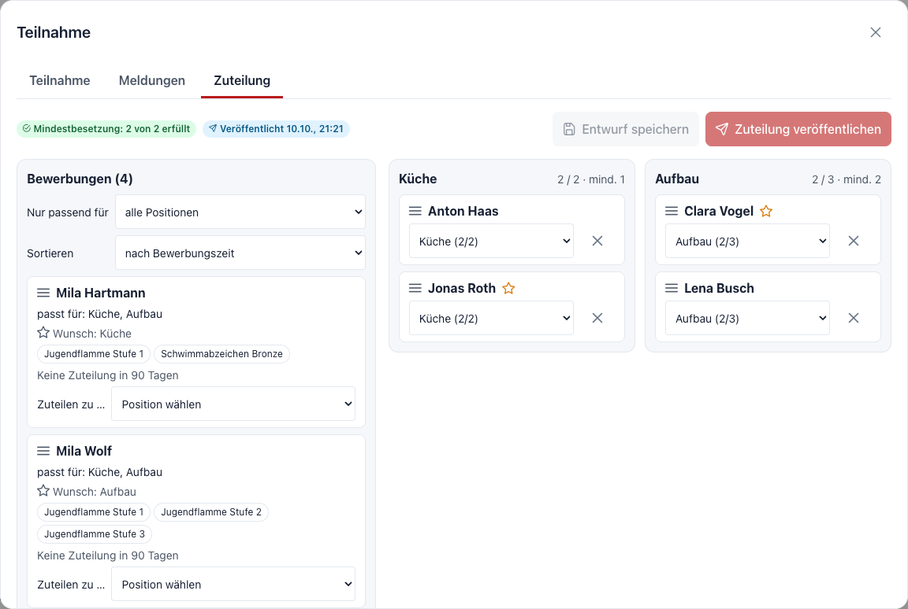
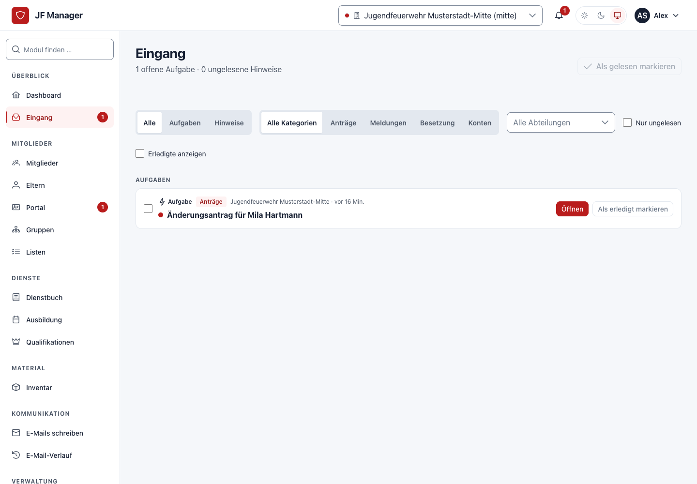
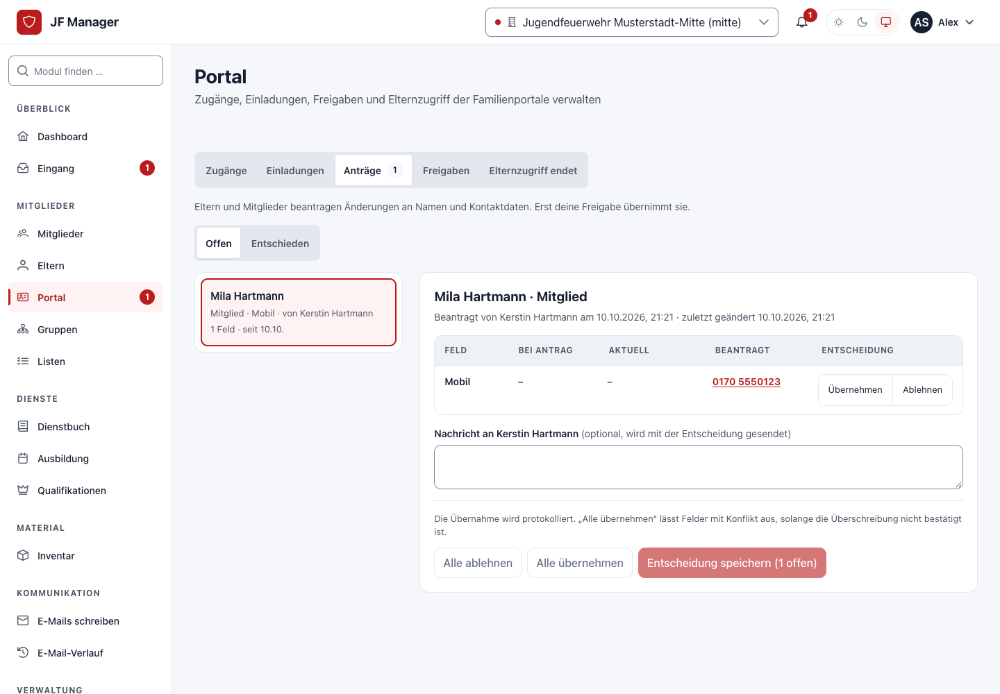

# Teilnahme, Positionen und Zuteilung

Für geplante Dienste legst du fest, wer sich anmelden darf, wie viele Plätze es gibt und ob du die Plätze selbst zuteilst. Eltern und Mitglieder melden sich im [Portal](../portal.md) an oder ab; im Dienstbuch siehst du diese Meldungen bei der Anwesenheit.

### Teilnahme für einen Dienst einstellen

Öffne die Übung im **Übungsplaner** und wähle **Teilnahme** (auf schmalen Bildschirmen unter **Weitere Aktionen**). Im Reiter **Teilnahme** stellst du ein:

| Einstellung | Bedeutung |
| --- | --- |
| **Abmeldung** | Alle aus der Zielgruppe sind erwartet und melden sich bei Bedarf ab. Positionen gibt es in diesem Modus nicht. |
| **Anmeldung** | Nur wer sich anmeldet, nimmt teil. Plätze werden in der Reihenfolge der Anmeldung vergeben. |
| **Zuteilung** | Personen bewerben sich, du verteilst die Plätze auf einem Board und veröffentlichst das Ergebnis. |
| **Fristen** | Anmelde- und Abmeldeschluss. Danach sind Änderungen nur noch durch die Leitung möglich. |
| **Voraussetzungen** | Regeln wie Mindestalter oder Qualifikationen. Die Vorschau zeigt, wer sie erfüllt, auch über eine höhere Qualifikation („erfüllt durch …“). |

*Positionen mit eigener Regel, Mindest- und Höchstzahl. Die Kopfzeile nennt, ob die Mindestbesetzung erfüllt ist.*

### Positionen, Plätze und Warteliste

Lege unter **Positionen** fest, welche Aufgaben es gibt (zum Beispiel Wachführung und Truppmann/-frau), wie viele Plätze jede hat und wie viele mindestens besetzt sein müssen. Das Gesamtmaximum ergibt sich aus den Positionen und zusätzlichen Plätzen ohne Position.

- Wer „beliebig“ wählt, bekommt die knappste passende Position.
- Ist eine Position voll, landet die Person auf der **Warteliste** dieser Position.
- Wird ein Platz frei, rückt bei automatischer Warteliste die erste passende Person nach und wird benachrichtigt. Bei manueller Warteliste erhältst du im **Eingang** die Aufgabe „Platz frei“.
- Sagt kurz vor dem Dienst jemand ab und die Mindestbesetzung ist gefährdet, meldet der Eingang das ebenfalls.

Belegte Positionen lassen sich nicht verkleinern oder löschen; verschiebe vorher die Personen.

### Meldungen ansehen

Der Reiter **Meldungen** zeigt Zusagen, Absagen, Wartelisten und Bewerbungen mit Position oder Wunsch und Herkunft der Meldung (Elternkonto, selbst, Betreuende).

### Plätze zuteilen

Im Modus **Zuteilung** öffnest du den Reiter **Zuteilung**. Links stehen die Bewerbungen mit passenden Positionen, Wunsch und Qualifikationen, rechts die Positionen mit Belegung.

Ziehe eine Person auf eine Position. Ungeeignete Positionen werden beim Ziehen grau und nennen den Grund. Ohne Maus wählst du bei der Person **Zuteilen zu …** und die Position.

*Animation: Zuteilung per Drag-and-drop. Die Tastatur- und Touch-Alternative „Zuteilen zu …“ steht bei jeder Person.*

Das Board ist zunächst ein **Entwurf**. Mit **Zuteilung veröffentlichen** erhalten die Zugeteilten ihre Position und eine Mitteilung; die anderen Bewerbungen bleiben offen oder werden als nicht ausgewählt markiert. Hat jemand anderes inzwischen etwas geändert, zeigt das Board den aktuellen Stand und speichert deinen Entwurf nicht ungefragt.

### Besetzungsvorlagen

Wiederkehrende Besetzungen (zum Beispiel eine Brandsicherheitswache) speicherst du als **Besetzungsvorlage** und wendest sie auf neue Dienste an. Die Vorlage wird kopiert; spätere Änderungen an der Vorlage verändern bestehende Dienste nicht. Übungsvorlagen und Serien übernehmen die Besetzung ebenfalls.

### Meldungen bei der Anwesenheit

In der Anwesenheitserfassung, auf der eigenen Anwesenheitsseite wie im Reiter **Anwesenheit** unter **Dienst bearbeiten**, siehst du bei jeder Person den Meldestatus. Mit **Abmeldungen als entschuldigt übernehmen** trägst du abgemeldete Personen in einem Schritt als entschuldigt ein; bereits erfasste Anwesenheiten bleiben unverändert.

### Eingang und Änderungsanträge

Der **Eingang** sammelt Aufgaben und Hinweise für dein Team, zum Beispiel freie Plätze, gefährdete Mindestbesetzung oder neue Anträge. Die Glocke im Kopf zeigt die Zahl offener Aufgaben.

Eltern und Mitglieder können im Portal Änderungen an Kontaktdaten beantragen. Unter **Portal → Anträge** prüfst du jeden Antrag feldweise: übernehmen oder ablehnen, bei Konflikten mit zwischenzeitlich geänderten Daten mit ausdrücklicher Bestätigung. Eigene Anträge prüft immer jemand anderes.

