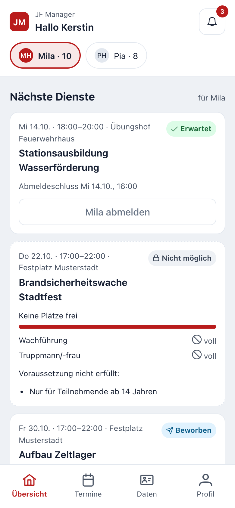
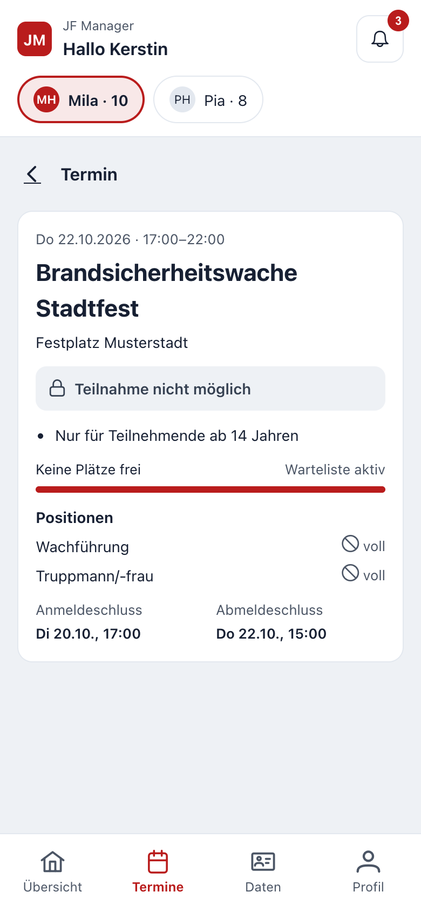
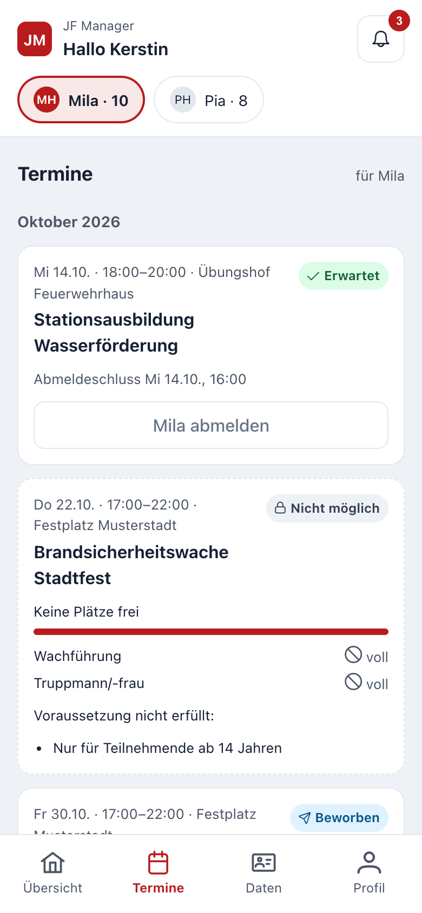

# Portal für Eltern und Mitglieder

Das Portal ist der eigene Zugang für Eltern und Mitglieder. Es zeigt nur, was die Leitung freigibt: kommende Termine, eigene Meldungen und ausgewählte Stammdaten. Anwesenheiten, Notizen und das Dienstbuch sind im Portal nicht sichtbar.

### Zugang einrichten

Die Leitung schickt dir eine Einladung per E-Mail. Über den Link legst du dein Passwort fest und bestätigst den Datenschutzhinweis. Danach meldest du dich auf derselben Seite an wie das Team; das Portal öffnet sich automatisch. Im **Profil** kannst du zusätzlich einen zweiten Faktor oder einen Passkey einrichten.

Eltern sehen alle verknüpften Kinder; oben wählst du, für wen du gerade handelst. Der Elternzugang zu einem Kind endet mit dessen 18. Geburtstag, sofern die Leitung ihn nicht verlängert.

### An- und abmelden

Unter **Übersicht** und **Termine** stehen die kommenden Dienste mit Status, zum Beispiel **Erwartet**, **Angemeldet**, **Warteliste** oder **Nicht möglich**.

- Bei Diensten mit **Abmeldung** bist du erwartet und meldest dich nur bei Bedarf ab.
- Bei Diensten mit **Anmeldung** meldest du dich an, solange Plätze frei sind; sonst kommst du auf die Warteliste.
- Bei Diensten mit **Zuteilung** bewirbst du dich und kannst optional eine Wunschposition angeben. Die Leitung entscheidet und du erhältst eine Mitteilung.
- **Zeitraum abmelden (z. B. Urlaub)** meldet alle noch möglichen Dienste in diesem Zeitraum auf einmal ab.

*Positionen zeigen nur, ob noch Plätze frei sind, nie wer schon angemeldet ist. „Nicht möglich“ nennt die fehlende Voraussetzung.*

Nach dem Anmelde- oder Abmeldeschluss sind Änderungen nur noch über die Leitung möglich.

### Daten prüfen und Änderungen beantragen

Unter **Daten** siehst du die freigegebenen Stammdaten. Stimmt etwas nicht, beantragst du die Änderung direkt dort. Die Leitung prüft den Antrag und übernimmt ihn oder lehnt ihn mit Begründung ab; du siehst den Stand am jeweiligen Feld.

### Mitteilungen

Die Glocke zeigt neue Hinweise, zum Beispiel neue Termine, Nachrücken von der Warteliste oder Zuteilungen. Unter **Profil → Mitteilungen** legst du fest, welche Hinweise du zusätzlich per E-Mail oder Push bekommst. Jede Teilnahme-E-Mail enthält einen Link zum Abmelden und zu diesen Einstellungen.
